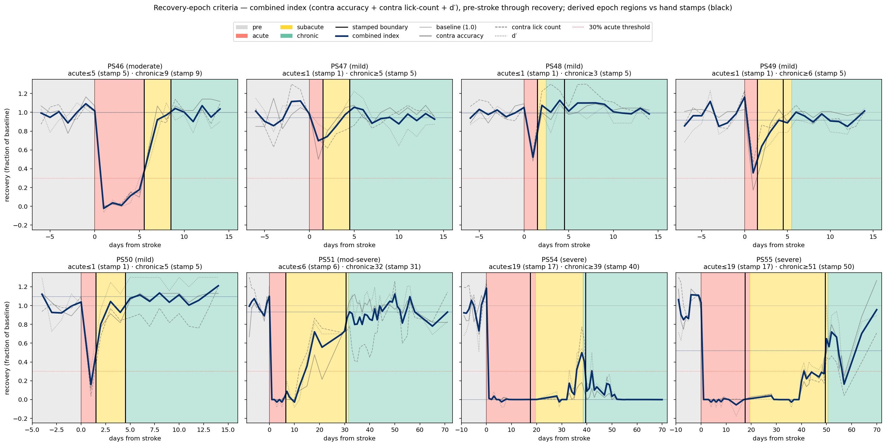

# Formal recovery-epoch criteria (acute / sub-acute / chronic)

A reproducible, FaceRhythm-independent formalization of the per-animal recovery
epochs that were hand-stamped into `configs/animals.yaml`
(`AnimalInfo.epoch_boundaries`). Code:
[`src/stroke_orofacial/stats/epoch_derivation.py`](../src/stroke_orofacial/stats/epoch_derivation.py),
runnable via [`scripts/run_epoch_derivation.py`](../scripts/run_epoch_derivation.py)
(writes a comparison CSV + the figure below to `pipeline_outputs/epochs/`).

The stamped `animals.yaml` boundaries remain **authoritative**. This criterion
exists to make the epoch definitions defensible and re-derivable from the
already-computed stats inputs, not to replace the hand calls.

## The combined recovery index

Three per-session signals from `stats/inputs/no_filter/`, each normalized to its
pre-stroke baseline (mean of the last 5 pre-stroke sessions) and averaged:

- **contralesional first-lick accuracy** (`first_lick_accuracy_all`, contra) —
  does the mouse lick the correct side *when it licks*;
- **contralesional correct-lick count** (`num_correct_licks_per_trial`, contra) —
  how *much* it licks the correct side (engagement / vigor);
- **session discriminability `d_prime`** — overall side discrimination.

The key empirical fact: **accuracy recovers fast, but lick-count and d′ recover
slowly.** E.g. PS55's contra *accuracy* is back to ~0.85 by day 33, but its
contra lick-*count* stays ~0 until day 40 and only plateaus (~6–7 licks/trial)
around day 50, and its d′ is flat at ~0 until day 40 then jumps to its ~3
plateau at day 50. The hand-stamped chronic boundaries track the **slow**
signals, so averaging the three makes the index follow them.

## The criterion

- **Acute.** `acute_max_rel_day = max(1, onset − 1)`, where `onset` is the first
  post-stroke day a *suppressed* side's first-lick accuracy recovers above 30 %
  of its baseline (end of the nadir). The `max(1, …)` floor guarantees at least
  one acute day.

- **Chronic.** `chronic_min_rel_day = max(plateau, acute_max + 2)`. The
  `plateau` is found in two steps: (1) **value-proximity** — locate the last
  *sustained* (≥ 2 consecutive sessions) deviation of the smoothed combined
  index from its terminal level (median of the last 4 sessions) by more than
  0.20 (fraction-of-baseline units); (2) **local slope-flattening** — from that
  session, walk forward only while the index keeps climbing (slope > 0.03 per
  day) and stop at the first flattening; the plateau onset is that day. The
  `acute_max + 2` term is a floor of ≥ 1 sub-acute day.

- **Sub-acute** is the span between (`acute_max < rel_day < chronic_min`).

Three design choices: (1) **value-proximity** locates the plateau robustly; (2)
**local slope-flattening** then extends it through the tail of the rise, so a
steep-but-real recovery (PS46) plateaus where its slope flattens (day 9) rather
than where the value first gets close (day 7) — and because the walk stops at
the first flat session it cannot be re-triggered by later noise, so the slow
recoverers don't overshoot; (3) the **≥ 1-day sub-acute floor** binds only for
the genuinely flat mild animals (which have no measurable rise to flatten). Net
effect: every animal except the flat mild cases has its sub-acute width fall out
of the recovery index directly.

## Validation against the hand stamps

| animal | phenotype | acute_max (stamp → derived) | chronic_min (stamp → derived) | sub-acute (days) | plateau source |
| --- | --- | --- | --- | --- | --- |
| PS46 | moderate | 5 → **5** | 9 → **9** | 3 | index |
| PS47 | mild | 1 → **1** | 5 → **5** | 3 | index |
| PS48 | mild | 1 → **1** | 5 → 3 | 1 | index (recovered by d2) |
| PS49 | mild | 1 → **1** | 5 → 6 | 4 | index |
| PS50 | mild | 1 → **1** | 5 → **5** | 3 | index |
| PS51 | mod-severe | 6 → **6** | 31 → 32 | 25 | index |
| PS54 | severe | 17 → 19 | 40 → 39 | 19 | index |
| PS55 | severe | 17 → 19 | 50 → 51 | 31 | index |

**Chronic reproduces the stamps within ±1 day for all 8 animals** (PS46, PS47,
PS50 exact), and the boundary is now driven by the recovery index for every
animal — the `MIN_SUBACUTE_DAYS = 1` floor never binds. PS48's chronic lands at
day 3 (vs stamped 5) because its combined index returns to baseline by day 2
(no rise to extend through); the stamp's two extra days are a nominal margin.
The acute misses (PS54, PS55: derived 19 vs stamped 17) are a recording-cadence
artifact: there is no recording session between rel_day 17 and 20, so the first
observable post-nadir recovery is at day 20, forcing `acute_max = 19`. This is a
session-spacing limit, not a criterion error.

The figure plots each animal's index from the pre-stroke baseline through
recovery; normalized to baseline, the pre-stroke index sits near 1.0 (grey
reference line), making the post-stroke deficit depth visible in context.

## Caveats

- N = 8, exploratory; thresholds (30 % acute, 0.20 plateau tolerance, ≥ 2-session
  sustain, ≥ 3 sub-acute days) are cohort-tuned. They are exposed as module
  constants in `epoch_derivation.py` for re-tuning.
- The severe group's late dynamics are genuinely noisy (sparse sessions, large
  session-to-session swings), so their plateau day is the least certain.
- `acute` resolution is bounded by recording cadence (see PS54/PS55 above).
