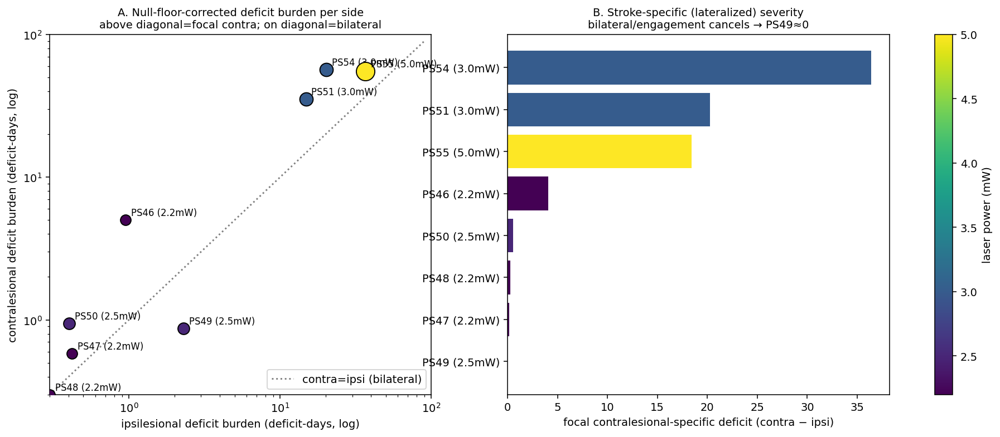
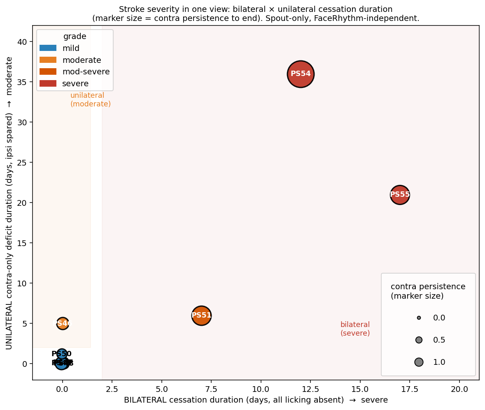
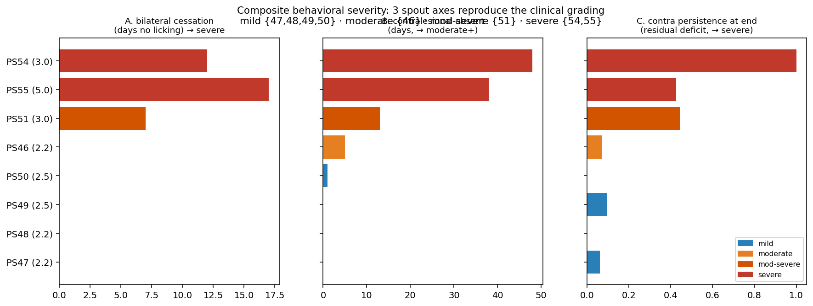

# Behavioral stroke-severity scoring (FaceRhythm-independent)

Per-animal stroke severity derived purely from spout (lick) behavior — the
`licks_and_rewards` Phase-2 outputs — across the full cohort PS46–55 (laser
2.2–5.0 mW). Code: [`src/stroke_orofacial/severity.py`](../src/stroke_orofacial/severity.py),
runnable via [`scripts/run_severity_burden.py`](../scripts/run_severity_burden.py)
(writes CSV + figure to `pipeline_outputs/severity/`).

Companion to the AR-HMM project (`AR-HMM_behavior` repo), where these labels
will be cross-checked against a FaceRhythm-based manifold-distortion biomarker.

## Metric: integrated deficit burden (per side)

For each animal, build the per-session **correct-response** time series — mean
licks within 3 s of the same-side tone — for the contralesional and ipsilesional
sides (mouse-frame, mapped to ipsi/contra via `AnimalInfo.mouse_side_to_ipsi_contra`).
Baseline = mean of the last 5 pre-stroke sessions. The severity metric is the
**integrated fractional deficit over post-stroke days** (area between baseline and
the response curve; "deficit-days"), computed *separately* per side:

```
burden_side = ∫ max(0, 1 − response(t)/baseline) dt   over post-stroke days
```

**Null-floor correction.** The rectified integral counts *any* sustained
sub-baseline drift, so for low-engagement animals normal session-to-session noise
accumulates a spurious "deficit." We subtract each animal's **pre-stroke**
rectified-deficit rate (a per-side noise floor) before integrating, so only genuine
post-stroke excess scores. (Effect is modest here; e.g. PS55 ipsi 48.7 → 36.7.)

**Focal (stroke-specific) deficit.** Per-side burden still conflates a focal
contralesional lesion with a general bilateral reduction in engagement. The
stroke-specific severity is the **lateralized** component, `max(0, contra − ipsi)`:
a bilateral/engagement reduction cancels, and only a contra≫ipsi deficit (the focal
lesion signature) scores > 0. This is the right number for "how bad is the focal
stroke," distinct from total burden (which also flags severe-bilateral animals).

### Why not simpler metrics (iterations that were rejected)
- **Contra *fraction* of licks** breaks down for severe animals: when licking
  ceases entirely the fraction is computed from ~0 licks and is meaningless.
- **Total-licking recovery time** understates moderate animals — ipsi licking is
  intact, so *total* recovers fast even while the contra side is still impaired.
  Contra-*specific* recovery is the meaningful axis.
- **Equal-weighted z-score of [contra depth, ipsi depth, contra rec, ipsi rec]**
  wrongly conflated PS46 and PS50: PS46's deep, lasting contra deficit was offset
  by a transient one-session ipsi dip in PS50. The integrated burden (depth ×
  duration, per side) fixes this and keeps lateralization explicit.

## Results



Null-floor-corrected burdens (deficit-days) and the focal (contra−ipsi) deficit:

| animal | laser (mW) | contra burden | ipsi burden | **focal deficit** | group |
| --- | --- | --- | --- | --- | --- |
| PS54 | 3.0 | 56.6 | 20.2 | **36.4** | severe |
| PS51 | 3.0 | 35.1 | 14.8 | **20.3** | moderate-severe |
| PS55 | 5.0 | 55.1 | 36.7 | **18.4** | severe (most bilateral → lower *focal*) |
| PS46 | 2.2 | 5.0 | 1.0 | **4.1** | moderate (focal, lateralized) |
| PS50 | 2.5 | 0.9 | 0.4 | 0.5 | mild |
| PS48 | 2.2 | 0.3 | 0.0 | 0.3 | mild |
| PS47 | 2.2 | 0.6 | 0.4 | 0.2 | mild |
| PS49 | 2.5 | 0.9 | 2.3 | **0.0** | mild (no focal deficit) |

- **Total burden** (contra+ipsi) gives the overall spectrum PS54≈PS55 > PS51 ≫ PS46 ≫
  mild four — validated against laser power, which the metric never saw.
- **Focal deficit** (contra−ipsi) is the *stroke-specific* axis: PS54 highest, PS46 a
  clear focal moderate; PS55 has high total but *lower focal* because its deficit is the
  most bilateral; **PS49 = 0** (see below).
- **PS49 has no real ipsilesional stroke deficit.** Its raw ipsi burden (2.6) came from a
  small, *sustained* ~20% post-stroke reduction — but it is **not contralesionally
  specific** (contra ~90% retained, *less* affected than ipsi ~80%), the opposite of a
  focal-lesion signature. That pattern is a mild general engagement reduction, not a
  lateralized deficit, so its focal deficit is ~0 and it groups mild.
- **PS46 ≫ PS50**: a lasting focal contralesional deficit (focal 4.1) vs mild (0.5).

## Composite clinical grade (recommended)

The burden/focal metrics above are continuous severity *scores*. To reproduce the
**clinical grading** (mild / moderate / moderate-severe / severe) we combine three
interpretable spout axes — each matching a stated diagnostic criterion
(`severity_grade()` in `severity.py`):

- **A — bilateral cessation days**: post days with *both* responses < 25% baseline
  (acute total absence of licking). → drives *severe* / *mod-severe*.
- **B — contra-absent days**: post days with the contralesional response < 25%
  baseline (duration of absent contra licking). → drives *moderate*.
- **C — contra persistence**: residual contra deficit over the last ~6 sessions
  (does contra recover, or persist to the end?). → drives *severe*.

(The A and B suppression thresholds were originally 20% and 30%; they are unified
to 25%. The four-way grouping is invariant to this choice — verified at
20 / 25 / 30%, where the A/B counts shift slightly but never cross a grade
boundary.)

Rule (cohort-tuned, N=8): `severe` if C>0.6 (persists) or A≥10 (very long cessation);
else `mod-severe` if A≥2 (acute bilateral cessation that recovers); else `moderate`
if B≥3 (sustained contra-only); else `mild`.

Summary view — all three axes at once (x = bilateral cessation duration → severe;
y = unilateral contra-only deficit duration → moderate; marker size = contra
persistence). Each grade occupies its own region: mild at the origin, moderate up
the y-axis (unilateral), mod-severe/severe out along x (bilateral), with PS54's large
marker flagging the persistent (never-recovering) contra deficit.



Per-axis breakdown:



| animal | A (cessation d) | B (contra-absent d) | C (persistence) | grade |
| --- | --- | --- | --- | --- |
| PS47 | 0 | 0 | 0.06 | mild |
| PS48 | 0 | 0 | 0.00 | mild |
| PS49 | 0 | 0 | 0.09 | mild |
| PS50 | 0 | 1 | 0.00 | mild |
| PS46 | 0 | 5 | 0.07 | **moderate** (contra-only deficit, ipsi spared) |
| PS51 | 7 | 13 | 0.44 | **mod-severe** (acute bilateral, then recovers) |
| PS55 | 17 | 38 | 0.43 | **severe** (longest cessation) |
| PS54 | 12 | 48 | 1.00 | **severe** (contra deficit persists to end) |

This reproduces the clinical grading exactly: mild {PS47–50}, moderate {PS46},
mod-severe {PS51}, severe {PS54, PS55} — and shows *which axis* drives each call
(PS46 = B; PS51 = A with recovery; PS54 = C persistence; PS55 = A duration).

## Caveats
- N = 8, exploratory. The severe group's burdens are lower bounds (recovery can
  extend beyond the recorded sessions). DLC tongue kinematics (protrusion-angle
  ipsi-bias, wrong-side licks) are an orthogonal refinement not yet included.
